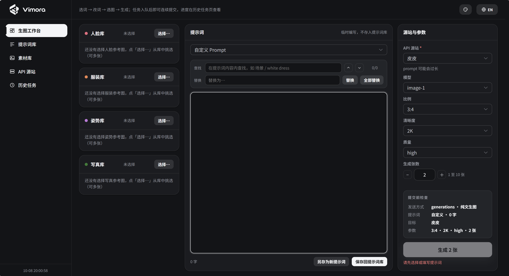

<div align="center">

<h1>
  <br>
  
</h1>

**自己的提示词、自己的素材，随取随用，组合出图。**

[](LICENSE)
[](https://www.python.org/)
[](https://fastapi.tiangolo.com/)
[](https://vuejs.org/)
[](https://www.mysql.com/)

[](https://gitee.com/menghahayl/vimora)

简体中文 | [English](README.en.md)

</div>

---



## 这是什么

Vimora 是一个 AI 生图工作台，重点解决的是**素材和提示词的维护与复用**：参考图进素材库、分类分组、随取随用；提示词存档、可搜可改、一键复用；选图改词一屏完成、提交即出图。出图走任意 OpenAI 兼容的中转站，结果按提示词自动归档。FastAPI + Vue 3 + MySQL，一条命令跑起来，内置 Mock 源站可以零额度走通全流程。

适合谁：需要反复"选词、改词、选图、生成、回看"的电商摄影 / 素材产出从业者，或任何想要一个不依赖云平台、图库和提示词都攥在自己手里的生图工作流的人。

## 核心优势

- **素材复用** —— 参考图一次上传、永久待命，分组管理，不用每次翻文件夹重传
- **提示词资产化** —— 存档可搜、改完即存，告别在聊天记录里翻旧词
- **连续作业** —— 提交即入队、界面立即解锁，改改词接着提交，出图不用等图
- **过程可回溯** —— 每个任务带完整快照，出过的图按天按词归档，随时对比、一键重跑
- **不依附平台** —— 图、词、记录全在自己电脑，不受云端限流、停服、涨价影响

## 为什么做 Vimora

做电商摄影的日常，是把同一条提示词翻来覆去地改：换一套服装、换一个场景、换一个姿势，再生成、再对比。这件事在聊天框里做，改一次要翻一次历史；在云平台做，图库和提示词都不在自己手里。

Vimora 就是把这件每天重复几十次的事，做成一个顺手的工作台：参考图挂进素材库随取随用，提示词存档可搜可改，任务提交即入队、连续提交不等待，所有图和记录都落在自己电脑的磁盘和数据库里。

## 名字的由来

**Vimora = Vi + mora**。Vi 取自 *Vision*（视），mora 是拉丁语里的"片刻、停留"——**让所见停留成影像**：安静、可靠、不发花哨，专心盯图。

## 设计理念

- **干净整洁** —— 三栏一屏完成选图、改词、出图；石墨黑主题为长时间盯图优化，动效只表达状态反馈
- **方便可用** —— 装好就用，没有注册登录和团队配置；Mock 源站零额度练手，上手零成本
- **好维护** —— 素材库、提示词库想怎么分就怎么分，类别不写死，越用越贴合自己的工作流
- **自己的一套自己管** —— 所有数据落在自己电脑的数据库与磁盘里，随时备份、随时带走

## 功能特性

**工作台**
- 三栏布局：素材 ｜ 提示词 ｜ 参数，一屏完成选图、改词、出图
- 提交即入队、立即解锁界面，可连续提交多个任务
- 支持中英文界面切换（右上角一键切换，语言偏好持久化）

**素材库**
- 库与分组自由创建、自主维护，类别不写死，随工作流扩展
- 手动上传或按磁盘目录批量导入（一级子目录 = 组）
- 素材卡多选、分组筛选、动态分页，网格随分辨率自适应

**提示词**
- 提示词存档，关键词 / 标签搜索，真翻页大数据量支持

**源站与任务**
- OpenAI 兼容中转站管理：CRUD、连通性测试（`GET /v1/models`）、单站并发上限
- 有参考图走 edits 接口，无参考图自动走 generations
- 任务异步执行、快照重跑（rerun）、按天归档（`outputs/YYYY-MM-DD/`）+ 任务全字段 JSON 快照
- 历史任务页：状态 / 关键词过滤、运行中任务 2 秒轮询、失败原因带状态码与响应体片段

**界面**
- 石墨黑 / 纯白双主题 + 包豪斯红、甜酷玫粉、香芋紫、星光蓝、苹果青等经典配色板，跟随滚动条与 Element Plus 变量全局联动
- 浮层（抽屉 / 弹窗 / toast）磨砂玻璃质感，数据用等宽字体

## 快速开始

两种方式：**源码运行**（见下文），或直接使用打包好的 exe（整理中，后续发布到 [Releases](https://gitee.com/menghahayl/vimora/releases)，届时无需自行搭建 Python 环境）。

### 环境要求

- Python 3.9+
- Node.js 16+（前端开发 / 构建）
- MySQL 8.x（本机或可达远程）

### 1. 启动后端

```bash
pip install -r requirements.txt
cp .env.example .env      # 按需修改数据库连接等配置
python run.py             # 默认 http://127.0.0.1:8765
```

启动时自动建库建表；若账号无建库权限，先手工执行：

```sql
CREATE DATABASE image_gen_platform DEFAULT CHARSET utf8mb4;
```

### 2. 启动前端

```bash
cd frontend
npm install
npm run dev               # 开发模式，自动代理 /api、/files 到 8765
```

打开终端给出的地址即可使用；接口文档在 `http://127.0.0.1:8765/api/docs`。

### 3. 零额度跑通全流程（Mock）

1. 「源站管理」新建一个 Mock 类型源站；
2. 「素材库」建组、上传几张参考图；
3. 「工作台」选素材、写提示词、选 Mock 源站，提交任务；
4. 「历史任务」轮询至 `success`，结果图在 `outputs/<日期>/` 下，按提示词归档。

> 想接真实出图：在「源站管理」填入任意 OpenAI 兼容中转站的地址与 API Key 即可，其余流程完全一致。

### 配置项

复制 `.env.example` 为 `.env` 按需修改（`.env` 不覆盖已存在的环境变量）：

| 变量 | 默认 | 说明 |
| --- | --- | --- |
| `DB_HOST` / `DB_PORT` | `127.0.0.1` / `3306` | MySQL 地址 |
| `DB_USER` / `DB_PASSWORD` | `root` / 空 | 数据库账号（需建库权限） |
| `DB_NAME` | `image_gen_platform` | 业务库 |
| `TEST_DB_NAME` | `image_gen_platform_test` | 测试库（pytest 用，自动建删） |
| `DATA_DIR` | `data` | 素材库落盘根目录 |
| `OUTPUT_DIR` | `outputs` | 生图结果落盘根目录 |
| `MAX_CONCURRENT_TASKS` | `2` | 单个源站的并发上限（每站独立计数） |
| `APP_PORT` | `8765` | 服务端口 |

## 测试

```bash
python -m pytest tests/ -v
```

测试使用独立的 `TEST_DB_NAME` 测试库，落盘指向临时目录，不污染真实 `data/` 与 `outputs/`。

## 目录结构

```
app/                    # FastAPI 后端
├── config.py           # .env / 环境变量配置
├── database.py         # 建库建表、engine/会话
├── models.py           # ORM（prompt/library/asset_group/asset_image/provider/gen_task/task_image）
├── routers/            # prompts / libraries / providers / tasks
├── services/           # storage（素材落盘）/ generator（出图与结果落盘）/ task_runner / mock_provider
└── utils/              # 文件名安全化、图片读写
frontend/               # Vue 3 + Vite + Element Plus 前端
└── src/theme.css       # 双主题与配色板 token
tests/                  # pytest 回归测试
data/                   # 素材库落盘（运行时生成）
outputs/                # 生图结果归档（运行时生成）
```

## 后续计划

- [ ] 任务批量重跑与批量导出
- [ ] 提示词变量模板（占位符批量套参考图）

> 有想法？欢迎提 [Issue](https://gitee.com/menghahayl/vimora/issues) 或直接提 PR。

## 贡献

欢迎 Issue 与 PR：提 Bug 请附复现步骤与日志；改界面请保持现有的克制动效与黑白基调。提交前请跑一遍 `python -m pytest tests/`。

## License

本项目基于 [GNU AGPL-3.0](LICENSE) 协议开源——可自由使用、修改、分发（含商用），但修改后的版本或以网络服务形式对外提供时，须按相同协议开放完整源码。

Copyright (c) 2026 Vimora contributors
